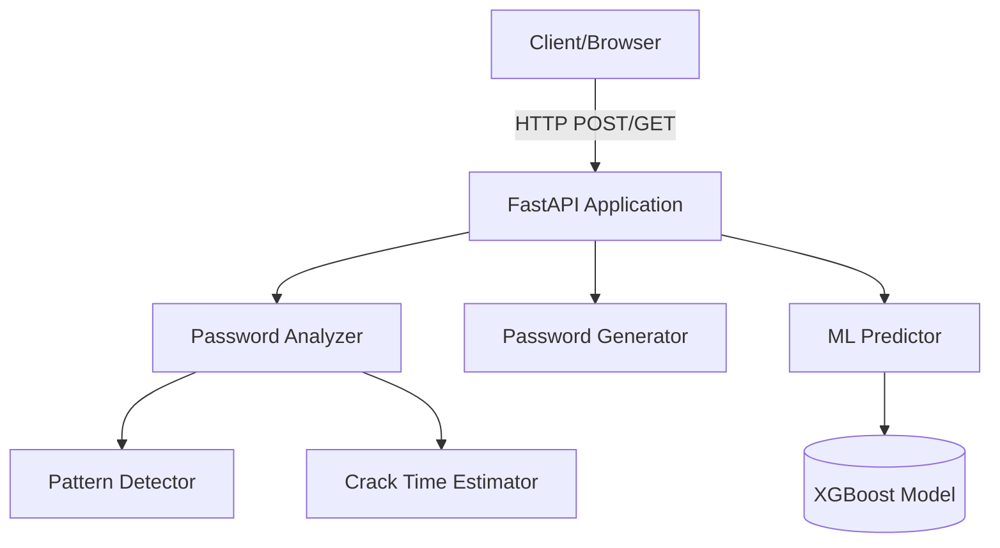

# 🔐 PassStrength AI

[](https://www.python.org/downloads/)
[](https://fastapi.tiangolo.com)
[](https://opensource.org/licenses/MIT)

PassStrength AI is an advanced, AI-powered password strength analysis and generation tool. It employs machine learning alongside traditional heuristic checks to evaluate password complexity, estimate crack times, and generate secure passwords.

## ✨ Features

- **AI-Driven Analysis**: Predicts password strength using machine learning models (XGBoost/scikit-learn).
- **Pattern Detection**: Identifies dictionary words, keyboard walks, repeated characters, and sequential patterns.
- **Crack Time Estimation**: Calculates realistic crack times based on entropy and hardware capabilities.
- **Password Generation**: Customizable secure password generator with options to exclude ambiguous characters.
- **RESTful API**: Fast and fully typed API endpoints powered by FastAPI.
- **Dockerized**: Easy to deploy anywhere with the included Docker configuration.

## 🏗️ Architecture



## 📸 Screenshots

*(Add screenshots here)*

## 🚀 Installation

### Local Setup

1. **Clone the repository:**
   ```bash
   git clone https://github.com/yourusername/passchecker.git
   cd passchecker
   ```

2. **Create a virtual environment:**
   ```bash
   python -m venv venv
   source venv/bin/activate  # On Windows: venv\Scripts\activate
   ```

3. **Install dependencies:**
   ```bash
   pip install -r requirements.txt
   ```

4. **Run the server:**
   ```bash
   uvicorn main:app --reload
   ```

### Docker Setup

1. **Build the image:**
   ```bash
   docker build -t passchecker .
   ```

2. **Run the container:**
   ```bash
   docker run -d -p 8000:8000 passchecker
   ```

## 📖 API Documentation

Once running, access the interactive API docs at `http://localhost:8000/docs`.

### Key Endpoints

- `GET /api/health`: Check service health.
- `POST /api/analyze`: Analyze a password.
  - **Request Body:** `{"password": "MySecretPassword123!"}`
- `POST /api/generate`: Generate a new password.
  - **Request Body:** `{"length": 16, "exclude_ambiguous": true}`
- `POST /api/predict`: Get ML prediction for given features.
- `GET /api/model-info`: Retrieve current ML model details.

## 📁 Project Structure

```text
passchecker/
├── app/
│   ├── api/          # FastAPI routers and endpoints
│   ├── ml/           # Machine Learning models and training scripts
│   ├── services/     # Core logic (Analyzer, Generator, etc.)
│   └── tests/        # Pytest test suite
├── Dockerfile        # Docker build instructions
├── requirements.txt  # Python dependencies
└── main.py           # Application entry point
```

## 🧠 ML Model Details

The application uses an XGBoost classifier trained on various password datasets. Features extracted include length, character diversity, entropy, and known pattern matches to predict a robustness score.

## ☁️ Deployment

- **Docker:** Use the provided Dockerfile.
- **Render/Railway:** Connect your GitHub repo and deploy directly.
- **AWS EC2:** Launch an instance, install Docker, and run the image.

## 🤝 Contributing

Contributions are welcome! Please open an issue or submit a Pull Request for any enhancements or bug fixes.

## 📄 License

This project is licensed under the MIT License - see the [LICENSE](LICENSE) file for details.
